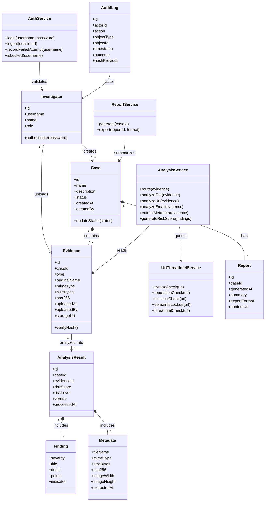
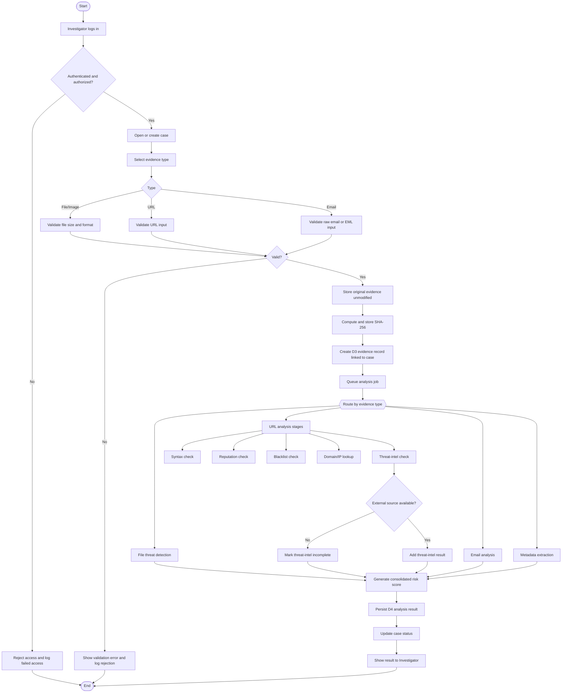
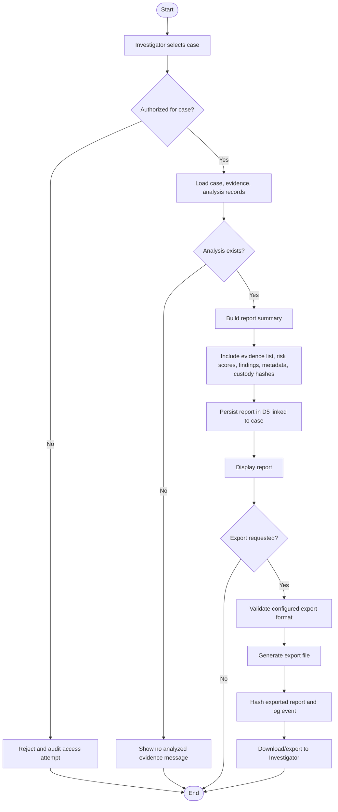

# AI Powered Digital Forensics and Investigation Platform Audit

Sources reviewed:

- SRS: `C:\Users\saksh\Downloads\SRS_AI_Digital_Forensics_Platform-4.docx`
- Lab Assignment 5: `C:\Users\saksh\Downloads\Documents\Lab Ass 5 Class and Activity Write Up.pdf`
- Lab Assignment 6: `C:\Users\saksh\Downloads\Documents\Lab Assignment 6.pdf`
- Lab Assignment 7: `C:\Users\saksh\Downloads\Documents\lab7 ppt_PBL III.pdf`
- Current implementation: `C:\Users\saksh\Downloads\ff\indexers.html`

Note: no `docs/` directory was visible in the current workspace. The audit therefore uses the documents explicitly supplied in the request. No code was modified.

## 1. Requirements Extracted From The SRS

### Investigator Authentication

| SRS ID | Expected requirement |
|---|---|
| REQ-AUTH-1 | Authenticate an Investigator against D1 - Users before access to any other feature. |
| REQ-AUTH-2 | Reject invalid login attempts with a generic error that does not disclose whether username or password was wrong. |
| REQ-AUTH-3 | Lock an account after a configurable number of consecutive failed login attempts. Threshold is TBD in Appendix C. |
| SRS 5.3 / Business Rule | Only authenticated Investigators may create cases, upload evidence, or trigger analysis. |

### Case Management

| SRS ID | Expected requirement |
|---|---|
| REQ-CASE-1 | Authenticated Investigator can create a case with at least case name, description, and creation timestamp. |
| REQ-CASE-2 | Investigator can retrieve, update, and view status of cases stored in D2 - Cases. |
| REQ-CASE-3 | Every evidence item and report is associated with exactly one case. |
| SRS 5.5 | Evidence and reports must be traceable to exactly one case. |

### Evidence Upload

| SRS ID | Expected requirement |
|---|---|
| REQ-EVID-1 | Accept evidence of type File, URL, Email, and Image. |
| REQ-EVID-2 | Persist each uploaded evidence item in D3 - Evidence with parent case link and immutable upload timestamp. |
| REQ-EVID-3 | Validate uploaded files against accepted formats and maximum size before storage. Formats and size are TBD. |
| REQ-EVID-4 | Preserve original evidence artifacts unmodified for chain of custody. |
| SRS 5.2 | Do not automatically execute or open uploaded files in a way that compromises host or evidence integrity. |

### File Threat Detection And Metadata Extraction

| SRS ID | Expected requirement |
|---|---|
| REQ-ANLY-1 | Route each evidence item by artifact type: File Analysis, URL Analysis, Email Analysis, or Metadata Extraction. |
| REQ-ANLY-2 | Perform Threat Detection in Files and flag known indicators of compromise. |
| REQ-ANLY-3 | Perform Metadata Extraction on applicable evidence types and store metadata with the analysis record. |

### URL Analysis And Threat Intelligence

| SRS ID | Expected requirement |
|---|---|
| REQ-URL-1 | Perform URL syntax check before further analysis. |
| REQ-URL-2 | Perform reputation check against a reputation-scoring source. |
| REQ-URL-3 | Perform blacklist check against known-malicious URL/domain lists. |
| REQ-URL-4 | Retrieve Domain/IP information for the URL. |
| REQ-URL-5 | Query external threat-intelligence source. |
| REQ-URL-6 | Consolidate URL sub-analysis outputs into a single URL Analysis Result and persist it to D4 - Analysis. |
| SRS 5.4 | Degrade gracefully if external threat-intelligence source is unavailable, and flag incomplete results rather than failing silently. |

### Risk Score And Analysis Storage

| SRS ID | Expected requirement |
|---|---|
| REQ-ANLY-4 | Generate consolidated Risk Score from File, URL, Email, and Metadata outputs for each evidence item. |
| REQ-ANLY-5 | Prepare and persist final Analysis Result to D4 - Analysis linked to source evidence and case. |
| SRS 2.5 | Analysis results must be traceable to originating evidence record and case. |

### Report Generation And Export

| SRS ID | Expected requirement |
|---|---|
| REQ-RPT-1 | Generate Investigation Report summarizing case details, evidence analyzed, risk scores, and key findings. |
| REQ-RPT-2 | Persist generated report in D5 - Reports linked to source case. |
| REQ-RPT-3 | Present Analysis Result, AI Report, and current Case Status to Investigator. |
| REQ-RPT-4 | Allow export of a generated report. Export formats are TBD. |

### Evidence Integrity, Access Control, Encryption, Audit Logging

| SRS section | Expected requirement |
|---|---|
| SRS 2.5 | Preserve chain of custody and evidentiary integrity for all uploaded artifacts. |
| SRS 3.4 | Client-server communication occurs over HTTPS. API style, auth scheme, and async messaging are TBD. |
| SRS 5.3 | Encrypt all evidence and case data at rest and in transit. |
| SRS 5.3 | Restrict access to cases and evidence to authenticated, authorized Investigators. |
| SRS 5.3 | Log all access to D3 - Evidence and D4 - Analysis for chain-of-custody and audit. |

## 2. Requirements Traceability And Gap Matrix

Status meanings:

- Complete: implemented in a way that satisfies the SRS behavior and security assumptions.
- Partial: present in the UI or prototype, but incomplete, client-only, non-persistent as required, not server-side, or missing acceptance-level controls.
- Missing: not implemented or contradicted by the current implementation.

| SRS ID | Expected behavior | Current HTML implementation | Status | Defect, risk, or limitation | Verification test |
|---|---|---|---|---|---|
| REQ-AUTH-1 | Authenticate against D1 - Users before any feature access. | Login gate uses `d1_users` in `localStorage`, session in `sessionStorage`, seeded demo user. | Partial | Authentication is client-side and user store is editable in browser storage; no server-side D1 or authorization enforcement. | Attempt access before login; inspect storage edit bypass; verify server rejects unauthenticated API calls once backend exists. |
| REQ-AUTH-2 | Generic invalid-login error. | Wrong credentials return "Invalid credentials." | Partial | Empty fields produce a different validation message, acceptable for UX, but client-side login can be inspected or bypassed. | Submit unknown user and wrong password for known user; confirm same generic message. |
| REQ-AUTH-3 | Configurable account lockout after failed attempts. | `MAX_LOGIN_ATTEMPTS=5`; lockout for 30 seconds in `localStorage`. | Partial | Threshold is hard-coded and SRS threshold is TBD; lockout is client-side and removable by clearing storage. | Five invalid attempts lock account; clearing localStorage must not reset lockout in final system. |
| REQ-CASE-1 | Create case with name, description, timestamp. | Modal creates case with name, description, status Open, created timestamp, createdBy. | Partial | Stored only in browser storage; no server-side D2; timestamps mutable. | Create case and verify required fields persisted in durable data store. |
| REQ-CASE-2 | Retrieve, update, view status of existing cases. | Lists and opens cases; status displayed. | Partial | No case update workflow or status transition workflow; status appears fixed as Open except seed data. | Update case description/status; reload and verify persistence and audit entry. |
| REQ-CASE-3 | Evidence and reports each linked to exactly one case. | Evidence and reports contain `caseId`. | Partial | No referential integrity; browser storage can create orphan or cross-case records; no server validation. | Attempt evidence/report creation without valid caseId; expect rejection. |
| REQ-EVID-1 | Accept File, URL, Email, Image. | Upload selector supports file, image, URL, email text/file. | Partial | Browser-only ingestion; email file handling is limited; no durable artifact storage. | Upload each supported type and verify typed evidence record and analysis route. |
| REQ-EVID-2 | Persist evidence in D3 with parent case and immutable timestamp. | Stores metadata record in `d3_evidence` with `caseId`, `uploadedAt`, hash. | Partial | Original bytes/content are not persisted for most uploads; timestamp and records are mutable in localStorage. | Upload evidence; reload from server; verify immutable timestamp cannot be edited by user/API. |
| REQ-EVID-3 | Validate accepted formats and max size before storage. | Enforces 25 MB file size for selected files. No accepted-format allowlist. | Partial | SRS formats and size are TBD; HTML accepts any file and does not validate URL/email text size. | Boundary tests at max-1, max, max+1; accepted and rejected extensions. |
| REQ-EVID-4 | Preserve original artifacts unmodified. | Computes SHA-256, then stores metadata, not artifact bytes. | Missing | Chain of custody cannot be proven because original evidence is not preserved. Hash alone is insufficient without retained artifact and audit trail. | Upload file; download/retrieve original; hash must match original bytes. |
| REQ-ANLY-1 | Route evidence by artifact type. | `prepareAnalysisResult()` routes URL, email, otherwise file/image to file analyzer. | Partial | Routing exists, but all processing is client-side and no asynchronous analysis queue. | Upload each type and verify route-specific analysis record. |
| REQ-ANLY-2 | File threat detection and IOC flagging. | Static browser heuristics inspect extension, magic bytes, PE strings, entropy, embedded URLs/IPs, commands, packer hints. | Partial | Good prototype heuristics, but not validated as server-side service, no maintained IOC feeds, no malware-safe sandboxing contract, no model provenance. | Known benign and suspicious samples produce expected flags without executing files. |
| REQ-ANLY-3 | Metadata extraction stored with analysis. | Stores name, size, MIME, SHA-256, upload date, caseId; image dimensions if loadable. | Partial | Metadata is shallow; no EXIF, email header metadata is separate; original artifact unavailable for re-extraction. | Upload image with EXIF and email with headers; verify expected metadata fields stored. |
| REQ-ANLY-4 | Consolidated risk score per evidence item. | Sums finding points, caps at 100; maps to clean/low/medium/high. | Partial | Risk scoring is undocumented, client-modifiable, not calibrated or tested against acceptance criteria. | Inputs with no, low, medium, high findings produce expected score bands. |
| REQ-ANLY-5 | Persist analysis linked to evidence and case in D4. | Analysis record in `d4_analysis` includes `evidenceId`, `caseId`. | Partial | No durable D4; no referential integrity; records can be edited/deleted locally. | Verify analysis cannot be created for missing evidence/case and persists after server restart. |
| REQ-URL-1 | URL syntax check. | Uses browser `new URL()`. | Partial | Accepts some syntactically parseable URLs that may not meet business policy; no configured URL scheme policy. | Valid HTTP/HTTPS and malformed URLs. |
| REQ-URL-2 | Reputation check against reputation source. | Local heuristic reputation string based on score/indicators. | Missing | No external reputation-scoring source. | Mock reputation API returning benign/malicious/timeout. |
| REQ-URL-3 | Blacklist check against known-malicious lists. | Static in-code blacklist domains. | Partial | Local static list is not a maintained external/source-backed blacklist. | Known listed and unlisted domains; update feed and retest. |
| REQ-URL-4 | Retrieve Domain/IP information. | Stores simple host/domain field; checks IP-like host patterns. | Partial | No DNS, WHOIS, registrar, ASN, geolocation, resolved IPs, or passive DNS lookup. | URL domain lookup returns resolved IP and domain metadata or marked unavailable. |
| REQ-URL-5 | Query external threat-intelligence source. | No network calls; no external source. | Missing | Threat-intel requirement not satisfied; cannot detect external outage. | Simulate threat-intel hit and outage; verify result and incomplete flag. |
| REQ-URL-6 | Consolidate URL checks and persist to D4. | `analyzeUrl()` returns syntax/reputation/blacklist/domain/threatIntel/verdict and persists in analysis record. | Partial | Consolidation exists, but based on local heuristics, not SRS-specified external checks. | URL analysis result contains all sub-check fields and links to evidence/case. |
| SRS 5.4 | External threat-intel outage degrades gracefully and flags incomplete result. | Not applicable because no external threat-intel call exists. | Missing | No outage state, retry, timeout, partial-result marker, or user warning. | Mock outage; expected status "incomplete threat-intel check" and no silent clean verdict. |
| REQ-RPT-1 | Generate report with case, evidence, risk scores, findings. | Builds report summary and per-evidence findings. | Partial | Report omits chain-of-custody details, analyst notes, methodology/provenance, and export format decisions. | Generate report for case with multiple evidence types; verify required sections. |
| REQ-RPT-2 | Persist report in D5 linked to case. | Stores report in `d5_reports` with `caseId`. | Partial | Browser-only D5; mutable, no server persistence or immutable report versioning. | Generate report, reload from durable store, verify case linkage. |
| REQ-RPT-3 | Present analysis result, AI report, and case status. | Case detail shows evidence/results/status; Reports page and modal show reports. | Partial | Status workflow incomplete; results not authorization-controlled. | Verify investigator can view current status, analysis, and report for authorized case only. |
| REQ-RPT-4 | Export generated report. | Exports HTML file. | Partial | SRS export formats are TBD; likely PDF/DOCX needed for investigation deliverable. No signed/hash export. | Export configured formats; verify content and file integrity metadata. |
| SRS 2.5 | Preserve chain of custody and evidentiary integrity. | SHA-256 captured for uploads. | Partial | No original artifact storage, immutable audit trail, custody events, or tamper-evident records. | Upload, view, analyze, export evidence; verify append-only custody log and hash continuity. |
| SRS 3.4 | HTTPS client-server communication. | Single static HTML; no client-server API. | Missing | No HTTPS/API layer to secure; local file/browser storage does not meet SRS architecture. | All API calls must require HTTPS and reject HTTP in production. |
| SRS 5.3 | Encrypt case/evidence data at rest and in transit. | Browser localStorage/sessionStorage, no encryption. | Missing | Evidence, users, cases, analysis, reports can be read or modified locally. | Inspect storage; final system should show encrypted DB/object storage and HTTPS. |
| SRS 5.3 | Access restricted to authenticated, authorized Investigators. | UI hidden until login; all local records available to any local logged-in user. | Partial | No server authorization, roles, ownership checks, or case-level access control. | User A cannot access User B case via URL/API/local ID. |
| SRS 5.3 | Log all access to Evidence and Analysis. | No audit log. | Missing | Cannot prove who viewed or modified D3/D4; chain of custody unsupported. | Access evidence and analysis; verify audit entries with actor, timestamp, action, object ID, outcome. |

## 3. Proposed UML Diagrams For This Application

The Lab Assignment 5 concepts call for classes, attributes, methods, and relationships for the static model, and activities, decisions, forks/joins, and final states for workflows. The following diagrams are tailored to this platform rather than copied from the assignment.

### Class Diagram

### Activity Diagram: Evidence Upload And Analysis

### Activity Diagram: Report Generation And Export

## 4. Planning And Risk Management Proposal

The Lab Assignment 6 guidance covers project goals, scope, WBS, resources, estimation, scheduling, risk analysis, execution, and monitoring. A manageable plan for this project should preserve the current front-end prototype while moving security-critical behavior to server-side services.

### Work Breakdown Structure

| WBS | Work package | Deliverable |
|---|---|---|
| 1 | Requirements baseline | SRS TBD decisions documented and traceability matrix updated. |
| 2 | Backend foundation | API, database schema for D1-D5, auth/session middleware, HTTPS-ready deployment config. |
| 3 | Authentication and access control | Server-side users, password hashing, lockout, authorization checks, automated auth tests. |
| 4 | Case management | CRUD/status workflow, case ownership/authorization, audit entries. |
| 5 | Evidence storage | Upload service, accepted format and size validation, immutable original artifact storage, SHA-256 verification. |
| 6 | Analysis pipeline | Queue-based analysis worker, file/email/metadata analysis modules, URL analysis integration boundaries. |
| 7 | Threat intelligence integration | Reputation, blacklist, domain/IP, and external threat-intel connectors with timeout/outage handling. |
| 8 | Risk scoring | Documented scoring rules, deterministic tests, calibration samples. |
| 9 | Reports | Report storage, viewer, configured export formats, report hash/audit events. |
| 10 | Test automation | Unit, API, UI, security, and black-box test suites integrated into CI. |

### Priority Risks

| Risk | Impact | Mitigation |
|---|---|---|
| Client-side auth/storage mistaken for compliance | High | Move D1-D5 to server-side data stores; treat HTML storage as prototype only. |
| Evidence chain of custody not provable | High | Store original artifacts immutably, compute hashes, maintain append-only audit log. |
| External threat-intel outages | Medium-High | Add connector timeouts, retries, partial-result status, and outage tests. |
| Unclear accepted formats/size/export formats | Medium | Resolve SRS TBDs or document development defaults before implementation. |
| Unsafe malware handling | High | Never execute uploads; use static analysis and sandboxed services only if explicitly designed. |
| Risk score lacks defensibility | Medium | Document scoring factors and maintain golden sample tests. |

## 5. Black-Box Test Plan

All tests below are designed only. They have not been executed. "Actual result" should remain "Not run" until automated or manual execution occurs.

Recommended automation candidates:

- UI tests: Playwright or Selenium for login, lockout, uploads, report export.
- API tests after backend implementation: pytest, Postman/Newman, or similar.
- Static sample tests: deterministic benign/suspicious files, URLs, and email fixtures.
- Security tests: authorization, storage tampering, audit logging, encryption configuration checks.

### Boundary Value Analysis

| Test ID | Scenario | Objective | Preconditions | Inputs | Steps | Expected result | Actual result | Status |
|---|---|---|---|---|---|---|---|---|
| BVA-AUTH-001 | Username minimum boundary | Verify accepted ID length boundary for registration/login policy. | Registration enabled. | 3, 4, 5 character IDs. | Register each ID. | 3 rejected; 4 and 5 accepted if otherwise valid. | Not run | Designed |
| BVA-AUTH-002 | Login lockout boundary | Verify lockout triggers at threshold. | Valid user exists; threshold documented. | Wrong password attempts N-1, N, N+1. | Submit invalid password repeatedly. | N-1 not locked; N locks; N+1 rejected as locked. | Not run | Designed |
| BVA-EVID-001 | Upload size boundary | Verify maximum upload size. | Logged in; case exists; max size configured. | Max-1 byte, max byte, max+1 byte files. | Upload each file. | Max-1 and max accepted; max+1 rejected before storage. | Not run | Designed |
| BVA-URL-001 | URL length boundary | Verify URL length handling if max URL length is defined. | Logged in; case exists; URL limit documented. | Length max-1, max, max+1. | Submit URL evidence. | Boundary behavior matches documented limit; rejected inputs not stored. | Not run | Designed |
| BVA-RPT-001 | Report export with zero analysis | Verify report generation boundary. | Case exists with zero analyzed evidence. | Generate report action. | Click generate report. | Report not generated; clear message displayed; event logged. | Not run | Designed |

### Equivalence Partitioning

| Test ID | Scenario | Objective | Preconditions | Inputs | Steps | Expected result | Actual result | Status |
|---|---|---|---|---|---|---|---|---|
| EP-AUTH-001 | Valid login | Verify authenticated investigator can enter app. | User exists. | Correct username/password. | Login. | Authenticated session created; dashboard accessible. | Not run | Designed |
| EP-AUTH-002 | Invalid login partitions | Verify generic failure. | User exists. | Unknown user, wrong password for known user. | Login with each. | Same generic invalid credentials error. | Not run | Designed |
| EP-EVID-001 | Accepted evidence types | Verify File, URL, Email, Image accepted. | Logged in; case exists. | Valid sample for each type. | Upload each. | Evidence records stored, linked to case, analysis created. | Not run | Designed |
| EP-EVID-002 | Rejected evidence types | Verify disallowed formats rejected once allowlist is defined. | Logged in; case exists; allowlist configured. | Unsupported extension/MIME. | Upload rejected file. | Rejected before storage; audit rejection recorded. | Not run | Designed |
| EP-FILE-001 | Benign file sample | Verify benign classification partition. | Logged in; case exists. | Plain text benign file. | Upload and analyze. | Low/clean result; no malicious IOC findings. | Not run | Designed |
| EP-FILE-002 | Suspicious file sample | Verify suspicious indicator partition without execution. | Logged in; case exists. | Text/script containing PowerShell encoded command/IOC strings. | Upload and analyze. | Suspicious/malicious findings; file is not executed. | Not run | Designed |
| EP-URL-001 | Benign URL | Verify benign URL partition. | Logged in; case exists. | `https://example.com/about` or controlled benign domain. | Submit URL. | Valid syntax, no blacklist/threat-intel hit, low/clean score. | Not run | Designed |
| EP-URL-002 | Suspicious URL | Verify suspicious URL partition. | Logged in; case exists. | IP URL, long encoded URL, suspicious TLD, blacklisted domain. | Submit URL. | Appropriate suspicious findings and risk score. | Not run | Designed |
| EP-URL-003 | External intelligence outage | Verify outage partition. | Threat-intel connector configured with mock timeout. | Valid URL. | Submit URL while connector unavailable. | Analysis completes with explicit incomplete threat-intel status. | Not run | Designed |
| EP-RPT-001 | Export report | Verify report export partition. | Case has analyzed evidence and report. | Configured export format. | Export report. | Export file generated with case, evidence, risk, findings, and hash/audit event. | Not run | Designed |

### State Graph Testing

| Test ID | Scenario | Objective | Preconditions | Inputs | Steps | Expected result | Actual result | Status |
|---|---|---|---|---|---|---|---|---|
| SGT-AUTH-001 | Login lifecycle | Validate auth transitions. | App opened. | Valid credentials; logout. | Logged Out -> Login Submitted -> Logged In -> Logout. | Only logged-in state can access protected views; logout clears session. | Not run | Designed |
| SGT-AUTH-002 | Lockout lifecycle | Validate failed-login states. | User exists. | Wrong password N times, wait lock duration, correct password. | Logged Out -> Failed Attempts -> Locked -> Lock Expired -> Logged In. | Locked state blocks login until expiry; final backend should not be reset by local storage clearing. | Not run | Designed |
| SGT-CASE-001 | Case lifecycle | Validate case status transitions. | Logged in. | Create, update status, close/reopen if supported. | No Case -> Open -> In Analysis -> Reported -> Closed. | Only allowed transitions succeed; status displayed and audited. | Not run | Designed |
| SGT-EVID-001 | Evidence lifecycle | Validate evidence and analysis states. | Case exists. | Upload valid evidence. | Not Uploaded -> Uploaded -> Queued -> Analyzing -> Analyzed -> Reported. | Each transition recorded; failed analysis enters Failed/Incomplete state with reason. | Not run | Designed |
| SGT-RPT-001 | Report lifecycle | Validate report states. | Case has analysis. | Generate/export report. | No Report -> Generated -> Viewed -> Exported. | Report persists and export action is audited. | Not run | Designed |

### Decision Table Testing

| Test ID | Scenario | Conditions | Expected action/result | Actual result | Status |
|---|---|---|---|---|---|
| DTT-AUTH-001 | Login decision | User exists: Yes; password correct: Yes; locked: No | Grant session. | Not run | Designed |
| DTT-AUTH-002 | Login decision | User exists: Yes; password correct: No; locked: No | Reject with generic error; increment failed count. | Not run | Designed |
| DTT-AUTH-003 | Login decision | User exists: No; password correct: N/A; locked: No | Reject with generic error; do not disclose unknown user. | Not run | Designed |
| DTT-AUTH-004 | Login decision | User exists: Yes; password correct: Yes; locked: Yes | Reject until lockout expires. | Not run | Designed |
| DTT-EVID-001 | Upload decision | Authenticated: Yes; case valid: Yes; type accepted: Yes; size within limit: Yes | Store evidence, hash artifact, queue analysis. | Not run | Designed |
| DTT-EVID-002 | Upload decision | Authenticated: No; case valid: Yes; type accepted: Yes; size within limit: Yes | Reject upload; no evidence stored. | Not run | Designed |
| DTT-EVID-003 | Upload decision | Authenticated: Yes; case valid: No; type accepted: Yes; size within limit: Yes | Reject upload; no orphan evidence. | Not run | Designed |
| DTT-EVID-004 | Upload decision | Authenticated: Yes; case valid: Yes; type accepted: No; size within limit: Yes | Reject before storage. | Not run | Designed |
| DTT-EVID-005 | Upload decision | Authenticated: Yes; case valid: Yes; type accepted: Yes; size within limit: No | Reject before storage. | Not run | Designed |
| DTT-URL-001 | URL decision | Syntax valid: No; reputation available: N/A; blacklist hit: N/A; threat-intel available: N/A | Mark invalid URL; do not run later checks except safe validation. | Not run | Designed |
| DTT-URL-002 | URL decision | Syntax valid: Yes; blacklist hit: Yes; threat-intel hit: Any | Mark malicious/high risk. | Not run | Designed |
| DTT-URL-003 | URL decision | Syntax valid: Yes; no hits; threat-intel unavailable: Yes | Complete partial analysis and flag incomplete source. | Not run | Designed |
| DTT-RPT-001 | Report decision | Case has analysis: Yes; user authorized: Yes; format supported: Yes | Generate/export report. | Not run | Designed |
| DTT-RPT-002 | Report decision | Case has analysis: No; user authorized: Yes; format supported: Yes | Do not generate; show actionable message. | Not run | Designed |
| DTT-RPT-003 | Report decision | Case has analysis: Yes; user authorized: No; format supported: Yes | Reject and audit unauthorized attempt. | Not run | Designed |

## 6. Prioritized Implementation Roadmap

The goal is to keep the app runnable after each stage and preserve useful current code: UI screens, heuristic analyzers, report layout, and traceability view can be retained as a prototype front-end while server-side services are added behind them.

### Stage 0 - Baseline And Decisions

- Freeze the current `indexers.html` as prototype baseline.
- Resolve or document defaults for SRS TBDs: lockout threshold, accepted formats, max size, export formats, supported browsers/hosting, API/auth scheme, performance/concurrency, compliance targets, retention/deletion.
- Add a requirements traceability document to the repo and mark client-only features as prototype only.
- Keep app runnable: no runtime behavior changes.

### Stage 1 - Backend Skeleton And Durable Stores

- Create server API and database schema for Users, Cases, Evidence, Analysis, Reports, AuditLog.
- Add HTTPS-ready deployment configuration for production.
- Preserve existing HTML as front-end, but start replacing localStorage calls with API calls behind a small data-access layer.
- Add smoke tests for health, login route, and case list route.

### Stage 2 - Server-Side Authentication And Authorization

- Move user credentials to server-side D1.
- Use secure password hashing, server sessions or JWT/OAuth2 per documented default, and server-side lockout.
- Add case/evidence/report authorization checks.
- Keep UI login/register flow but wire it to server.
- Add automated login, invalid login, lockout, logout, and unauthorized access tests.

### Stage 3 - Case Management

- Implement create/retrieve/update/status transitions in D2.
- Add referential integrity: cases own evidence and reports.
- Add audit entries for create/view/update/status changes.
- Keep existing dashboard/cases UI but populate from API.

### Stage 4 - Evidence Upload And Integrity

- Implement upload endpoint with accepted format and size validation.
- Store original artifacts unmodified in controlled storage; store SHA-256 and immutable upload timestamp.
- Reject unsupported files before storage; never execute uploaded files.
- Add chain-of-custody events for upload, view, analysis, report inclusion, and export.
- Add BVA/EP upload tests and hash verification tests.

### Stage 5 - Analysis Pipeline

- Move analysis execution to server-side worker/queue.
- Reuse current JavaScript heuristic logic as reference or port it into a tested server module.
- Add deterministic fixtures for benign files, suspicious scripts, suspicious URLs, and phishing emails.
- Store D4 analysis results with evidenceId and caseId.
- Keep app runnable by showing queued/analyzing/analyzed states.

### Stage 6 - URL Threat Intelligence Integration

- Add connectors for reputation, blacklist, domain/IP lookup, and external threat intelligence.
- Implement timeouts, rate-limit handling, and incomplete-result states.
- Add outage tests; do not silently mark evidence clean when a source fails.

### Stage 7 - Reporting And Export

- Implement D5 report persistence on the server.
- Support documented export formats, likely HTML plus PDF or DOCX if selected.
- Include case, evidence, risk score, findings, metadata, hashes, custody summary, and generation timestamp.
- Hash exported reports and audit exports.

### Stage 8 - Security Hardening And Test Automation

- Encrypt data at rest using selected DB/object-store mechanisms.
- Enforce HTTPS in production and secure cookies/session storage.
- Add audit-log tamper resistance or append-only storage design.
- Add CI with unit, API, UI, black-box, and security tests.
- Perform acceptance review against the SRS traceability matrix.

## 7. Unresolved SRS Decisions And Recommended Development Defaults

These should not be treated as final compliance decisions until documented by the project owner.

| SRS TBD | Recommended development default |
|---|---|
| System Administrator scope | Keep out of v1.0 unless explicitly added; implement Investigator only. |
| Supported browsers/server/hosting | Default to latest Chrome/Edge/Firefox, server on Linux container, HTTPS behind reverse proxy. |
| API style/auth/async messaging | REST API, secure server session or JWT, queue for analysis jobs. |
| Accepted formats and max size | Start with `.txt`, `.eml`, `.pdf`, common Office docs, common images, `.zip` if needed; 25 MB default only if approved. |
| Lockout threshold | 5 failed attempts, 15-minute server-side lockout, configurable. |
| Export formats | HTML plus PDF as default; DOCX only if required for coursework or investigator workflow. |
| Upload time/analysis turnaround/concurrency | Define measurable targets before performance testing; e.g., URL analysis under 10 seconds excluding external outages. |
| Compliance standards | Do not claim ISO/NIST/GDPR compliance until selected and tested. Use NIST SP 800-86/ISO 27037 as reference candidates only. |
| Retention/deletion policy | Default to no deletion of evidence artifacts in v1.0 except administrator-controlled retention process; document legal basis. |

## 8. Bottom-Line Audit Conclusion

The current HTML is a strong single-page prototype with useful UI, local heuristic analysis, risk scoring, report display/export, and a visible traceability table. It does not yet satisfy the SRS as an acceptance-ready forensic platform because the SRS assumes server-side services, persistent D1-D5 data stores, protected evidence storage, external threat-intelligence integrations, HTTPS, encryption, access control, and audit logging.

The highest-priority gap is not visual or functional polish; it is evidentiary trust. Browser storage, client-side authentication, mutable local records, and non-persistence of original artifacts prevent the current implementation from meeting chain-of-custody, authorization, encryption, and audit requirements.
